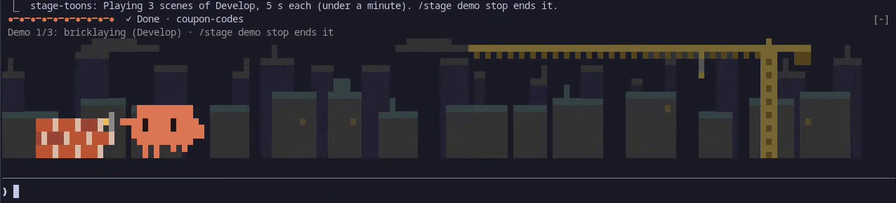
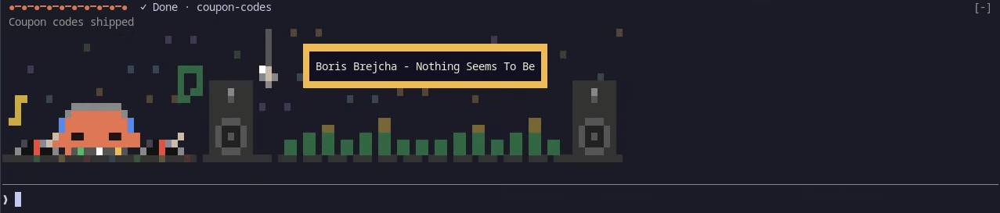

# stage-toons

A stepped progress bar of your development workflow, drawn above the Claude
Code prompt, with little pixel-art cartoons of Clawd in an area below the
bar while Claude works. When a Fable subagent comes in to audit or to
consult, a second, violet Clawd with a monocle walks on stage to review the
work.



```
 ●━●━●━●━◉─○─○─○─○─○  5/10 Plan · stage-toons
 Writing the implementation plan
```

- **A bar Claude moves** through your workflow (the default below, or
  your own), and that moves by itself on plain steps: a skill loaded, a
  spec written, a merge pushed.
- **41 pixel-art scenes** play while Claude works, with what Claude is
  doing over Clawd's head; an idle Clawd between turns; a row of helpers
  while agents work; Clawd DJ while Spotify plays.
- **History:** `/stage log` and `/stage time` show how long each stage
  took and what it cost.
- **Local and cheap:** no model requests; about 270 tokens of system
  prompt.

Inspired by [claude-toons](https://github.com/achimala/claude-toons) by
Anshu Chimala, whose Clawd sprite it borrows (MIT; see `NOTICE`). What
changed in each release is in the [CHANGELOG](CHANGELOG.md).

## Install

Needs Claude Code 2.1.288 or later with plugin hook modules (early
access). The cartoons draw in the terminal; the desktop app shows the bar
as text.

```sh
claude plugin marketplace add wmaq/wmaq-claude-mods
claude plugin install stage-toons@wmaq-claude-mods
```

Restart Claude Code; the mod then loads in every session. `/stage help`
is a guide to everything below. To run it from a clone, or to update, see
[Install, in full](#install-in-full).

## The stages

| # | Stage | What it means |
|---|---|---|
| 1 | Roadmap | Roadmap discussion and new-feature brainstorming |
| 2 | Brainstorm | Brainstorming one feature |
| 3 | Spec | Writing the spec |
| 4 | Spec audit | A Fable subagent audits the spec |
| 5 | Plan | Writing the implementation plan |
| 6 | Plan audit | A Fable subagent audits the plan |
| 7 | Develop | Building it |
| 8 | Claude testing | Claude verifies the work |
| 9 | Your testing | You test it |
| 10 | Cleanup | Leftovers, chores and docs |

Beside the track are two side stages, which the work can enter from any
point and leave again:

| Stage | What it means |
|---|---|
| Debugging | Finding and fixing a bug, at any point (`/stage debugging`) |
| Other | Anything that fits none of them (`/stage 0` or `/stage ?`) |

On a side stage the bar shows the stage instead of the track, and the track
stage the work returns to:

```
 Debugging · login bug   ↩ 7/10 Develop
 Reproducing the failing login test
```

Past the last stage is **Done**: the feature is merged, finished. The
whole track lights up, the bar reads `✓ Done · <feature>` with "Merged and
done" under it, Clawd gets the confetti, and one of Done's scenes plays
(fireworks, a rocket, or a victory lap):

```
 ●━●━●━●━●━●━●━●━●━●  ✓ Done · login
 Merged and done
```

The next move starts a new round: the feature is cleared (Claude names the
next one), and the track starts again from the beginning. A move back to
the stage Done came from (`/stage back`) reopens the feature instead, as
the undo of a mistaken Done.

This is the default workflow. A project can define its own (below).

## How the bar moves

Claude moves it. The mod gives Claude a `set_stage` tool and a short note in
the system prompt listing the stages; Claude calls the tool when the work
moves on (forwards, backwards or skipping) and writes the message under the
bar. Some steps move it by themselves (below). Progress is saved per
project directory and survives restarts.

You can move it yourself with `/stage`:

| Command | Effect |
|---|---|
| `/stage` | Show the stage and the recent moves |
| `/stage 5`, `/stage plan` | Move to a stage (`0` or `?` for Other) |
| `/stage debugging` | Move to a side stage by its id |
| `/stage next`, `/stage back` | One step (next from the last stage is Done; from Done, a new round) |
| `/stage done` | The feature is finished (merged); the next move starts a new one |
| `/stage feature <name>` | Name the feature (`/stage feature -` clears it) |
| `/stage message <text>` | Set the message |
| `/stage hide` | Hide or show the bar and the cartoons |
| `/stage demo [<stage> \| idle] [seconds]` | Play every scene, one stage's scenes (by id), or the idle routines, 10 s each (2 to 60); a bare number is the seconds |
| `/stage demo waiting [scene]` | Play the waiting toon with pretend agents (about 25 s): the next of its four scenes, or the one named (`laptops`, `building`, `rowing`, `conveyor`) |
| `/stage demo work [seconds]` | Play what Clawd shows while Claude works (thinking, each kind of tool, his lines), 3 s a step |
| `/stage demo dj [seconds]` | Play Clawd DJ (20 s): a long title, a track change, two helpers dancing |
| `/stage demo stop` | End the demo |
| `/stage workflow` | Show the workflow, where it came from, and each stage's scenes |
| `/stage workflow init` | Write the default workflow to `.claude/stage-toons.json` to edit |
| `/stage workflow reload` | Read `.claude/stage-toons.json` again and switch to it |
| `/stage auto [on \| off]` | Show the rules that move the stage by itself; turn them on or off |
| `/stage bubbles [on \| off]` | Whether Clawd's pop-ups show: what Claude is doing over his head, and what he says |
| `/stage calm [on \| off]` | Whether the cartoons hold still, changing only when something happens (off by default) |
| `/stage dj [on \| off]` | Clawd DJ: while Spotify plays, Clawd at the decks and the track's name (Windows, macOS, Linux; off by default) |
| `/stage dj party [on \| off]` | The DJ's full light show: speakers, floor, booth and box lighting up with the beat (off by default) |
| `/stage width [<n> \| full]` | How wide the cartoons may grow under the bar: up to n columns (120 by default; 48 to 512), or the band's whole width |
| `/stage log [n]` | The last n moves (15; up to 200) with how long each stage lasted |
| `/stage time` | Time per feature and per stage |
| `/stage help [<topic> \| commands]` | A guide to the mod: a line per feature; `/stage help <topic>` (`bar`, `auto`, `scenes`, `popups`, `waiting`, `idle`, `done`, `calm`, `width`, `dj`, `history`) explains one, with its commands and its setting now; `/stage help commands` lists every command (a `/stage` it doesn't understand answers one line, with the stage you may have meant) |

Claude is told about your moves.

### By itself

Some steps of the workflow are plain to see from what Claude does, and the
bar moves on them without waiting for `set_stage`. With the default
workflow and the [superpowers](https://github.com/obra/superpowers) skills:

| Claude... | The bar moves to |
|---|---|
| loads `superpowers:brainstorming` | Brainstorm |
| writes a file under `docs/superpowers/specs/` | Spec |
| starts a Fable subagent during Brainstorm or Spec | Spec audit |
| loads `superpowers:writing-plans`, or writes under `docs/superpowers/plans/` | Plan |
| starts a Fable subagent during Plan | Plan audit |
| loads `superpowers:executing-plans` or `superpowers:subagent-driven-development` | Develop |
| loads `superpowers:finishing-a-development-branch` | Cleanup |
| pushes to `main` or `master`, or runs `gh pr merge`, during Your testing or Cleanup | Done |
| loads `superpowers:systematic-debugging` | Debugging |

The bar only moves forward this way (or into Done, or a side stage):
fixing the spec during its audit, or ticking the plan's boxes while
developing, moves nothing. A push counts when Claude Code saw it go
through: one that was up to date, a `--dry-run`, a rejected push or a
deleted branch doesn't, and neither does a quiet one (`git push -q`), which
shows nothing; a push of several branches at once counts only the first. `gh pr merge` matches a command at the start of a line or
after `;`, `&&` or `|`, so a commit message that mentions one doesn't;
`gh pr merge --auto` merges nothing yet and doesn't either. A push or
merge the rules miss is a `/stage done` away; a default branch with
another name, such as `trunk`, needs a `push` rule of its own (below). From Done only a skill
you type moves the bar by itself (`/superpowers:brainstorming` starts the
next feature): the chores after a merge, Claude's own, stay in Done. Only
the main conversation counts, not subagents or teammates, and only files
written with Write or Edit. Claude is told of each such move with the
result of the call that made it (for a subagent, the call after it, as the
Agent call answers before the subagent starts), and still calls
`set_stage` for a better message or any other move. `/stage auto off`
turns this off, for every project; a workflow file sets its own rules, and
may start its project's sessions with them off (below).

### History

Each move is kept with the feature, who made it (Claude, you, or `auto`
and why) and how long Claude worked in it, for the last 200 moves.
`/stage log` lists the recent ones with how long each stage lasted;
`/stage time` totals the time per feature and per stage. Wall-clock time
counts the hours nobody worked (a night in Your testing); Claude's working
time is the time its turns ran. Done has no wall-clock time, as sitting
there is no work on the feature: its line says `done`, with Claude's time
after the merge. Both also show what the work cost, where it was counted:
dollars as `/cost` totals them (compaction and other plugins' model calls
included) and the tokens in and out of Claude's turns and its agents'.
While the session's cost can't be read, the dollars wait and go to the
stage current when it can again.

## While Claude works

The area plays the stage's scene, and over Clawd's head it shows what
Claude is doing right now:

- **thinking**: thought puffs rise over his head, and he looks up;
- **a tool at work**: a small icon for the kind of work (searching,
  reading, editing, testing, building, git, running a command, the web,
  agents) with a label naming what it touches (`auth.ts`, `npm test`);
  it stays a moment after the tool ends, so quick calls in a row don't
  flicker;
- **writing the answer**: a speech bubble filling with dots.

At a few moments he says a line in a speech bubble: `All green!` when
tests pass, `Red tests.` when they fail, `Committed!`, `Pushed!`,
`All done!` when Claude's last task is done, `Oops.` with a failed tool's
flinch, `Onward!` when the stage moves forward, `Hi, Fable!` when Fable
walks in. Every line is fixed: the mod asks no model for them.

While Claude keeps a task list, the bar counts it after the stage:
`5/10 Plan · 3 of 8 tasks · stage-toons` (with a `✓` when all are done;
a finished list goes at the next turn's start). On a narrow bar the
feature goes first, then the count.

The count comes from Claude Code's own task tools (`TaskCreate`,
`TaskUpdate`, `TodoWrite`), which Claude Code provides by default only on
older models (Opus up to 4.7, Sonnet up to 4.6, Haiku 4.5). On newer
models, start Claude Code with `CLAUDE_CODE_ENABLE_TODO_TOOLS=1` to see
it; without the tools there is no count, and nothing else changes.

`/stage bubbles off` turns the pop-ups off (the icons, labels, puffs and
bubbles) for every project; the scenes, the reactions and the tasks count
stay. `/stage demo work` plays them all, 3 s a step, even while they are
off.

## While Claude waits for you

The area below the bar is where Clawd lives: as wide as the band, up to
120 columns (`/stage width` changes it, up to 512 columns or the band's
whole width), and 9 rows high (8 or 7 in a shorter band). Each scene keeps
its picture at the area's left and runs its set on to the right edge (the
road, the table, the river), or fills the room with a few quiet props of
its own; the rows above the picture are headroom for Clawd's pop-ups. It
plays the stage's scene while Claude works, and the demos. When Claude
isn't working, a small Clawd stands at its left. He has five routines: the
classic one (he blinks, glances at the prompt and the bar, taps a foot),
Nyan Clawd (flying through a drifting starfield), coffee (he sips from a steaming mug), reading (he turns the
pages of a book) and yo-yo. One is picked each time a turn starts.
Whichever it is, after a minute he sits down and dozes off.

He marks a step finished, once: after the work moves forward on the track,
the next idle period has him show off the step's prop (a map for the
Roadmap, a light bulb for Brainstorm, a scroll for the Spec, a stamped page
for its audit, a checklist for the Plan, a clipboard for its audit, a
hammer for Develop, a test tube for Claude testing, a gift for Your
testing, a broom for Cleanup; a page with a tick for a stage of your own).
He lifts it, turns it over, then glances at you. In Done he celebrates
under confetti, every idle period, until the work moves on. A move you
make while Claude waits shows at once.

## While Claude waits on agents

When Claude's turn ends while agents still work (background subagents, a
Fable audit, teammates), Clawd walks aside with a cup of coffee and a row
of small helpers gets to work beside him, one for each agent at work, in
its model's colour: Sonnet magenta, Opus orange, Fable violet (with a
monocle), Haiku teal, any other model grey. Four seats on a 48-column area, one
more each 8 columns past it, eight at most; more agents wait for one to
free. A helper hops up and walks off when its agent finishes,
and when the last has gone Clawd walks back and his idle routine plays. He
doesn't doze while agents work.

Each wait plays one of four scenes, dealt at random like a stage's scenes
(each once before any again): the helpers type at **laptops**, build
brick **walls** that rise behind them (a flag on top when one is done),
**row** a long boat with their oars in time, or mark the boxes riding a
**conveyor** belt past them, each box keeping a mark from every helper
it passed. `/stage demo waiting` plays the next one with pretend agents;
`/stage demo waiting rowing` (or `laptops`, `building`, `conveyor`) plays
that one.

The area shows in a terminal at least 35 columns wide (30 for the band,
beside Claude Code's own mark) with room for the bar and 7 rows (8 or 9
rows of band; a taller band gives it up to 9 rows), whether or not Claude works; otherwise the bar is text
alone. A band you collapse shows no area.

Whatever the area shows next (Claude starting or stopping, a move to
another stage, Fable walking in or out, the helpers arriving, the doze, a
demo's next step), it dissolves into it over half a second, cell by cell.
A scene starts from its beginning each time it comes on, and a scene that
builds something up dissolves back to its start when it loops.

`/stage demo` plays all 41 scenes of the library in turn below the bar,
each named with the stage that plays it, so you can see them without
waiting for the work to reach each stage. `/stage demo plan` plays only the
scenes of one stage, `/stage demo idle` the idle routines and
`/stage demo waiting` the waiting toon, `/stage demo work` what Clawd
shows while Claude works and `/stage demo dj` Clawd DJ. A new prompt ends
the demo.

## Calm mode

`/stage calm on` holds the cartoons still, for every project: each
picture is one held frame, and the area changes only when something
happens. Claude starting or stopping, a move to another stage, Fable
coming or going, a helper arriving or leaving, the doze and the next
idle period each dissolve into the next still, as in motion. While
Claude works, Clawd holds a moment of the stage's scene; between turns
he stands still in his routine's pose, sits down to doze after a
minute, and shows off a finished step's prop or celebrates Done held
still. While agents work, the helpers sit at their seats in the wait's
scene, the work held part done.

The pop-ups stay, held still: what Claude is doing over Clawd's head
changes when the work does, and his lines show as they come. A
failure or a move forward shows only its line, without the hop. The
bar and its task count are unchanged. The demos move anyway, and the
stills come back when they end. `/stage calm off` brings the motion
back. With it on, the area looks for a change twice a second, and
sends the terminal a new frame only when something changed (and the
same one every 2 s, to learn that the area still shows).

## Clawd DJ



`/stage dj on` (in a terminal on Windows, macOS or Linux) has Clawd DJ
while Spotify plays, for every project: behind a booth with two
turntables, in headphones, bobbing to a 120 BPM beat (the media session
gives no tempo, so it follows the song only when the song is near 120),
speakers and a mirror ball over a dance floor. It plays on every stage,
between turns and while agents work: their helpers come down to the
dance floor and dance. Clawd's pop-ups show over his head as usual. From
72 columns a box by the mirror ball names the track, up to 60 characters
(a longer title scrolls; calm mode holds it, cut with `~`); a new track
swaps the record and brightens the box once. When Spotify pauses or
closes, the usual cartoons come back a read later. `/stage dj` says what
it last heard; `/stage dj off` stops it.

The booth is gentle by default, for long coding sessions: the lights
hold steady while Clawd, the records, the notes and the dancers move.
`/stage dj party on` lights it up with the beat: the speakers thump,
the floor tiles and the booth's LEDs blink, the mirror ball glints and
the box's frame pulses. Nothing flashes faster than twice a second.

How it reads Spotify, with no Spotify account, app or token:

- **Windows:** through Windows' media session with Windows PowerShell
  (`powershell.exe`, part of Windows). Spotify tells Windows only a
  track's first artist, so a track by two shows the first.
- **macOS:** through `osascript` (part of macOS). The first time it finds
  Spotify running, macOS asks whether your terminal (Ghostty, iTerm,
  Terminal…) may control Spotify; allow it and the music shows. Through
  tmux or another multiplexer, it is the terminal that started it that
  asks. With Spotify closed at `/stage dj on`, the question comes later,
  when Spotify first runs. If you said no, `/stage dj` says where to
  switch it on: System Settings › Privacy & Security › Automation, under
  your terminal's name; the music shows at the next read.
- **Linux:** through `playerctl` (MPRIS), which your package manager
  has (once it is installed, type `/stage dj on` again); Spotify from
  Flatpak works too. Spotify tells it only a track's
  first artist, as on Windows. Under WSL, Spotify plays on the Windows side, out of
  reach: run Claude Code in a Windows terminal for it.

A read takes about 0.1 to 0.3 s, every 5 s while the area shows and
every 30 s while it doesn't or Clawd sleeps with nothing playing. The
track stays in memory: it isn't saved, logged or sent to Claude. The box
writes Latin letters (with accents, Polish ones too), Greek and Cyrillic;
other characters (Japanese, Chinese, Korean, emoji) show as `?`.

## Your own workflow

A project can define its own stages in `.claude/stage-toons.json`.
`/stage workflow init` writes the default there to start from; edit it,
then `/stage workflow reload`. Without the file, the default applies.

A workflow has `track` stages, in order, and `side` stages, which the work
can enter from any point and leave again. Each stage has an `id` (what
`set_stage` and `/stage` take), a `label` for the bar, a `message` for the
status line, a `when` line telling Claude when to move there, and `scenes`:

```json
{
  "track": [
    { "id": "develop", "label": "Develop", "message": "Building it",
      "when": "writing the code", "scenes": ["bricklaying", "terminal"] }
  ],
  "side": [
    { "id": "debugging", "label": "Debugging", "message": "Hunting a bug",
      "when": "finding and fixing a bug, at any point", "scenes": ["bug-hunt"] }
  ]
}
```

A stage may also list `auto` rules: what, done in the main conversation,
moves the work into it (only forward on the track, into Done, or into a
side stage).
Each rule has one of `skill` (a skill's name; without a `plugin:` part it
matches any plugin's skill of that name), `write` (a glob on the file's
path from the project directory: `**` any run, `*` within a folder, `?`
one character), `agent` (a model family, such as `fable`, that a subagent
runs on), `bash` (a regular expression on a command) or `push` (a branch
a push went through to), and may add `from`, the stages it fires from:

```json
"auto": [
  { "skill": "superpowers:writing-plans" },
  { "write": "docs/superpowers/plans/**" },
  { "agent": "fable", "from": ["plan"] },
  { "bash": "git merge" },
  { "push": "trunk", "from": ["cleanup"] }
]
```

Up to 8 rules a stage. A `bash` rule may hold at most 4 repeats (`*`,
`+`, `?`, `{n,m}`) and may not repeat a group that itself repeats or
chooses (`(a+)*`, `(a|b)+`), which can take too long to match. It reads
each command of a line on its own (split at `;`, `&`, `|` and line
ends, so `^` and `$` match at each command's ends), the first 60
characters of each, up to the line's first 500: a word past a command's
60th character, such as a late `--auto`, goes unread. A glob holds at
most 8 `*`. The file's `when` lines are shown to Claude in the
system prompt, as CLAUDE.md is, and its labels, messages and rules in the
`[stage-toons]` notes Claude gets when the stage moves. A workflow file in which no stage has an
`auto` field takes the
default's rules for the stages it shares with the default by id; give any
stage an `auto` list, even an empty one, and the file has only its own.

Beside `track` and `side`, the file may set how a session on the project
starts: `"auto": false` with the rules off, `"hide": true` with the bar and
the cartoons hidden, `"bubbles": false` with Clawd's pop-ups off (and
`true` or `false` the other way), `"calm": true` with calm mode on (and
`false` with it off), `"width": 90` with the cartoons up to 90
columns wide (48 to 512, or `"full"`). Where the file sets one, it wins over
your own `/stage auto`, `/stage hide`, `/stage bubbles`, `/stage calm` or `/stage width` setting, at
each session's start and at `/stage workflow reload`; where it says
nothing, yours applies. The commands still change the session at once, and
say when the file starts it otherwise. `/stage workflow init` writes
neither.

```json
{ "auto": false, "hide": true, "track": [ ... ] }
```

Every workflow has Done past its track. The file may set its `message`,
`scenes` and `auto` rules in a `done` object (each optional; the rules as
a stage's, up to 8); without it, Done has the default message and scene
and no rules, as the default's name `user-test` and `cleanup`, which your
track may not have. The exception is a file in which no stage has an
`auto` field: Done then takes the default's merge rules too, from
whichever of `user-test` and `cleanup` the file has. `/stage workflow
init` writes the default's. A stage's rule may name `done` in its `from`,
but from Done only a skill you type moves the work:

```json
"done": {
  "message": "Shipped",
  "auto": [{ "bash": "(?:^|[;&|\\n])\\s*npm\\s+publish\\b", "from": ["release"] }]
}
```

A stage lists 1 to 5 scenes, dealt like a shuffled deck: each time the
work enters the stage it shows the next one, every scene once before any
repeats, never the same twice in a row. A
single `"scene": "bug-hunt"` works too. A workflow file keeps its own
lists: scenes added to the mod later reach it only when you add them.

Scenes: road-trip, light-bulbs, writing-desk, proofread-page,
stepping-stones, proofread-checklist, bricklaying, test-tubes, gift,
sweeping, bug-hunt, mystery-box, and the second and third scene of each
default stage: stargazing, sticky-notes, blueprint, red-pen, dominoes,
clipboard, terminal, control-panel, waiting-bench, dishes, flashlight,
fishing; treasure-map, thought-clouds, scroll, stamp, ladder, scales,
workbench, crash-test, cake, recycling, bug-net, dice; Claude testing's
fourth, bowling; and Done's, fireworks, rocket and victory-lap. `/stage
demo` plays them all, and a 41st,
fable-audit, which plays while a Fable subagent runs rather than for a
stage; `/stage workflow` shows the current workflow and its scenes.

Some scenes have scenery in layers across the whole area: road-trip's
hills and mountains go by at their own speeds, bricklaying has a city
behind it, and flashlight's torch shows a storeroom in the dark. Others
spread their action across it: the scroll unrolls to the edge, the
sticky notes go up along a board as long as the area, crash-test's car
runs the width into its barrier, and the bowling ball rolls a lane to
pins at the far end. Far
layers fade towards a dark grey (`#1e1e1e`), the usual dark terminal
background; on a light or a very different one they show as dim shapes
in a slightly different grey. The dark of flashlight's room is the
terminal's own background, on any theme.

Limits: 1 to 15 track stages, up to 5 side stages; ids are lowercase
letters, digits and dashes, and not one of `/stage`'s words (`next`,
`back`, `hide`, `demo`, `feature`, `message`, `workflow`, `auto`,
`bubbles`, `calm`, `dj`, `width`, `log`, `time`, `help`, `done`). A mistake in the file is reported with where it
is, and the session keeps a working workflow.

## Install, in full

The repository is a plugin marketplace. Add it once, install the mod, and
restart Claude Code; it then loads in every session:

```sh
claude plugin marketplace add wmaq/wmaq-claude-mods
claude plugin install stage-toons@wmaq-claude-mods
```

To update:

```sh
claude plugin marketplace update wmaq-claude-mods
claude plugin update stage-toons@wmaq-claude-mods
```

### From a clone

To run the mod from your own copy instead, clone the repository wherever
you keep your code:

```sh
git clone https://github.com/wmaq/wmaq-claude-mods.git
```

The mod is the `stage-toons` folder inside it. Below, `<path>` stands for
that folder's full path, such as `/home/you/src/wmaq-claude-mods/stage-toons` or
`C:\src\wmaq-claude-mods\stage-toons`.

- For one session: `claude --plugin-dir <path>`.
- For every session, add the folder to the `env` block of
  `~/.claude/settings.json` (on Windows, write each `\` in the path as
  `\\`), then restart Claude Code:

  ```json
  {
    "env": {
      "CLAUDE_CODE_PLUGIN_DIRS": "<path>"
    }
  }
  ```

To update, run `git pull` in the clone. Don't load it this way while the
marketplace copy is enabled: two stage-toons would load.

## What it costs

The cartoons are drawn locally: the mod makes no model requests. What it
adds to Claude's context:

- a short section in the system prompt (about 270 tokens, kept the same
  for a whole session so the prompt cache holds);
- Claude's occasional `set_stage` calls and their one-line answers;
- a one-line `[stage-toons]` note when the stage moves by itself or you
  move it with `/stage`.

What Clawd shows while Claude works comes from hooks on the tool calls and
on Claude Code's spinner (which it reads, not redraws): nothing reaches
Claude, and no model is asked.

## Development

```sh
claude plugin validate stage-toons
claude plugin test stage-toons
npx -y -p typescript@5 tsc -p stage-toons
```

`tsc` needs the editor types the engine writes into
`stage-toons/.claude-plugin/types/` the first time it loads the mod. CI
runs the first two on every pull request. `tools/frames/` renders the
drawing to PNG contact sheets, and `CLAUDE.md` at the repository root
has the engine notes learned building the mod.

## Credits

Written by wmaq with Claude Code. The Clawd sprite is adapted from
claude-toons (MIT, Copyright (c) 2026 Anshu Chimala). stage-toons is MIT
licensed; see `LICENSE`.

An independent project, not affiliated with or endorsed by Anthropic.
Claude and Claude Code are trademarks of Anthropic.
